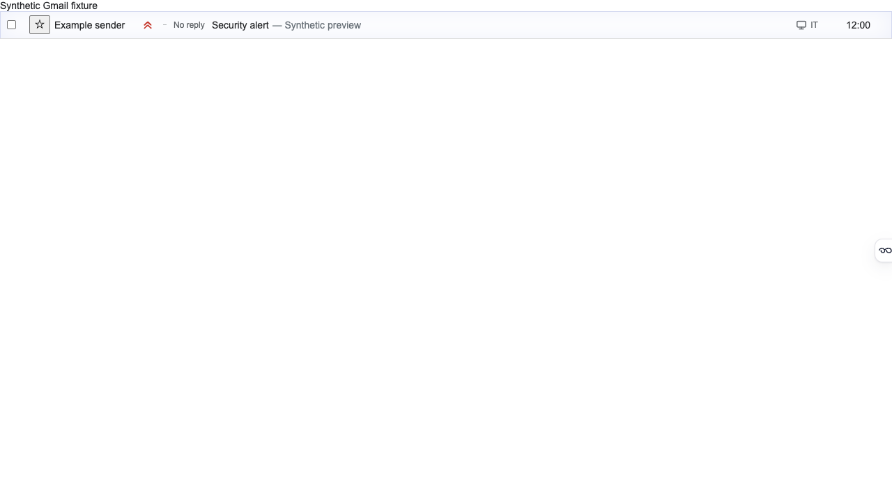
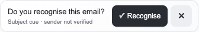
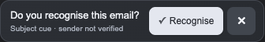

# Recognition sequence visual checkpoint

Synthetic browser captures from the packaged extension, not a real mailbox.
Frontend 0.2.7 is not published. Public download remains 0.2.6. Backend metadata
companion PR144 is deployed and verified from immutable maintenance commit
1cb73283120b753d4ae01359d2a4d696636093c6.

## Sequence and visual treatment

1. One soft lavender inset glow highlights the matching new email row for
   1400ms. No prompt appears while that animation is pending or running.
2. Actual animation completion starts a 160ms quiet gap. A bounded watchdog can
   recover only when no matching animation is pending/running; it cannot cut a
   delayed animation short.
3. A compact recognition control appears beneath the subject line with a subtle
   180ms entrance. It asks “Do you recognise this email?”, with a contrast-filled
   Recognise button and a separate dismiss control. The sender-verification note
   stays visible. This expands only the selected row while the question is open.

The prompt uses a neutral surface, fine border, soft shadow, 13px question and
36px controls. Dark mode adjusts the surface, text, border and control contrast.
The 640px capture keeps both controls visible on one line without horizontal
clipping. Subject, snippet, original marks and native Gmail actions are preserved.
Reduced motion shows the static prompt directly, with no glow, delay or entrance
motion. Message-key presentation history prevents animation replay on rerender.

## Captures

Glow phase, before the prompt:

Light and dark controls:

[Desktop context](desktop-prompt.png) · [640px context](narrow-prompt.png)

## Validation

Fresh post-reconnect packaged validation passed all five tests: both existing
snippet structures, public-origin pinning and both security-awareness cases.
The sequence test injects a 250ms CSS animation-start delay and records browser
animation/prompt timestamps. It verifies actual animation end precedes prompt
insertion, no row animation is active at insertion, and rerendering adds no glow.
Keyboard recognition, dismissal, acknowledgement persistence, reused/missing row
identity, account isolation, old unread mail, metadata/storage failure and reduced
motion remain covered. TypeScript/format checks pass; 287 unit tests passed.
Full exact-head CI and the requested visual checkpoint precede frontend merge
and public artifact verification. Screenshots verify the synthetic fixture only;
no authenticated real-mail/provider/model test was performed.
